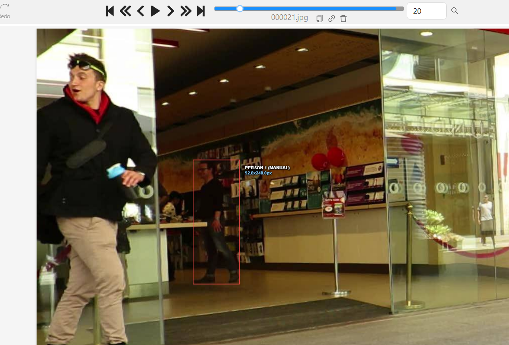
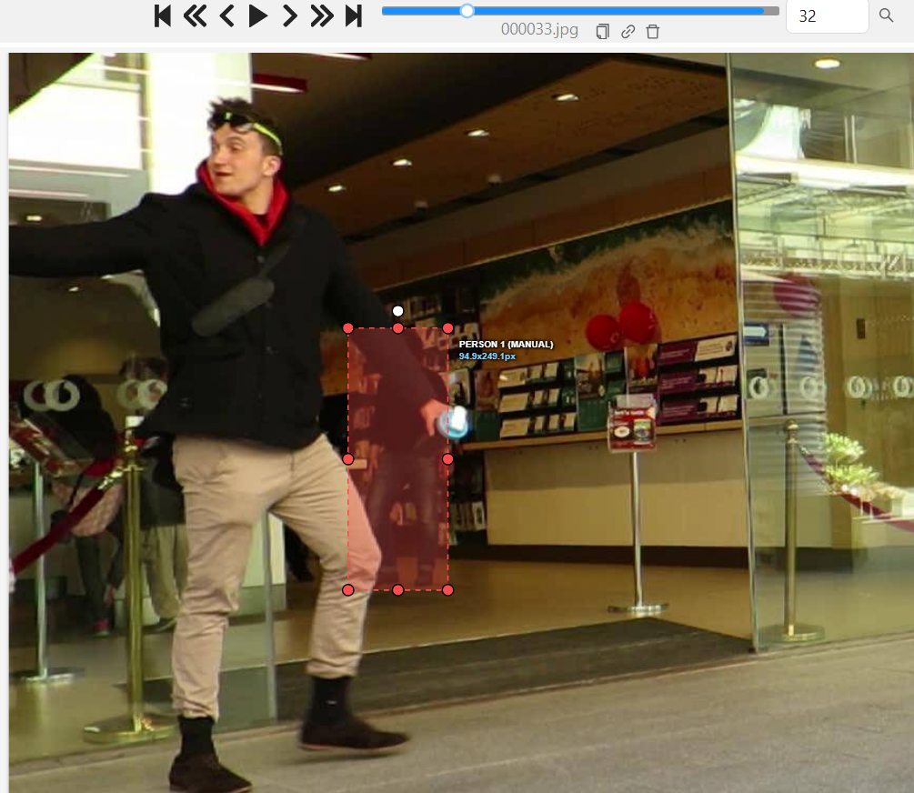
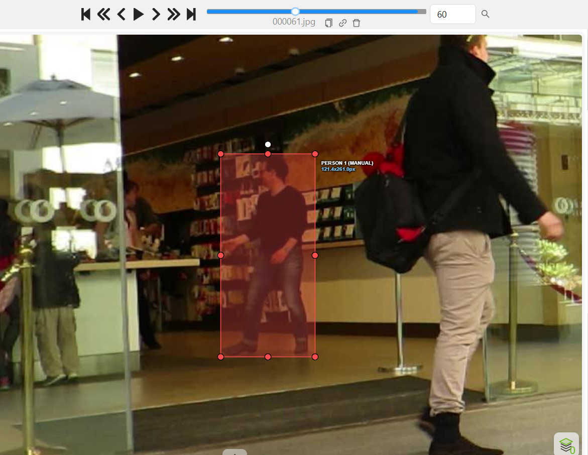

# Báo cáo cá nhân — Khưu Minh Phú-2A202603337

Đổi tên file theo quy tắc `MSSV_HoTen.md`. Ví dụ: `20241234_NguyenVanAn.md`.

Đoạn video: MOT17-09, 150 frame (frame 1–150), nguồn MOTChallenge, giấy phép CC BY-NC-SA 3.0.

## 0. Thông tin học viên

- Họ tên: Khưu Minh Phú
- MSSV: 2A202603337
- Mã đề (A/B/C): C
- Email: phukhuu39@gmail.com
- Link repository: https://github.com/kminhphu/K5-L2B-DAY05-KhuuMinhPhu-2A202603337-MOTTracking
- Giờ bắt đầu: 17h ngày 13/11/2026
- Giờ kết thúc: 22h ngày 13/11/2026

## 1. Xem trước đoạn video (CP0)

Ghi **trước khi vẽ**, mỗi người một dòng.

| Mã | Frame xuất hiện | Frame cuối thấy được | Rẽ / dừng / đổi tốc độ ở frame | Bị che ở frame | Ghi chú |
|---|---|---|---|---|---|
| P1 |0 |149 |Dừng ở frame 52 |30-55 | |
| P2 |60 |149 |Không có | Không có|60-80 |
| P3 |0 |149 |Không có |Không có | |
| P4 |0 |109 |Dừng ở frame 20 |90 | |
| P5 |0 |139 |Đổi tốc độ ở frame 48  |0-40 và 110 | |

## 2. Keyframe và thời gian (CP1, CP4)

Số keyframe lấy từ kết quả `src/check_submission.py`.

| Mã | Số keyframe | Keyframe ở frame | Số frame có mặt | Keyframe / 100 frame | Thời gian (phút) | Chỗ khó |
|---|---|---|---|---|---|---|
| P1 | 21| 0, 10, 20, 30, 46, 50, 54, 55, 56, 58, 60, 65, 75, 85, 95, 105, 115, 125, 135, 145, 149 | 143 |14.7 | 25 | Đoạn bị che và che mất hoàn toàn |
| P2 | 10| 60, 70, 80, 90, 100, 110, 120, 130, 140, 149  |90 |11.1 |15 |Xuất hiện từ chỗ bị che |
| P3 | 16| 0, 10, 20, 30, 40, 50, 60, 70, 80, 90, 100, 110, 120, 130, 140, 149 |150 |10.7 |20 |Không có |
| P4 | 9| 0, 10, 20, 30, 40, 50, 80, 90, 100 |110 |8.2 |15 |Đoạn bị che và che mất hoàn toàn|
| P5 | 13| 0, 10, 20, 30, 40, 50, 60, 70, 80, 90, 100, 110, 130 |130 |10 |20 |Đoạn bị che và che mất hoàn toàn |
| **Tổng** |69 | | 623|11.1 |95 | |

Keyframe / 100 frame của cả bài = tổng keyframe ÷ tổng số frame có mặt × 100 = 69 ÷ 623 × 100 = 11.1

Bạn đặt keyframe nhiều nhất ở người nào? Vì sao (người đó rẽ, dừng, lại gần camera hay bị che)?
Trả lời: Em đặt keyframe nhiều nhất ở P1 (21 keyframe). Vì P1 có đoạn bị che và biến mất rồi sau đó xuất hiện trở lại

## 3. Đoạn bị che (CP2)

Người bị che: `P1`

| Mốc | Frame |
|---|---:|
| Bắt đầu bị che một phần (bật `occluded`) | 30 |
| Mất hẳn (bật `outside`) | 39 |
| Hiện lại (tắt `outside`) | 46 |
| Thấy rõ trở lại (tắt `occluded`) | 55 |

- Thời gian khuất hẳn: 7 frame khoảng 0.3 giây.
- Quyết định: giữ cùng ID
- Lý do (trả lời 3 câu: khuất bao lâu so với 60 frame, ngoại hình có khớp, chỗ hiện lại có đúng hướng và tốc độ):
Trả lời: thời gian khuất chỉ có 7 frame và nhỏ hơn 60 frame, ngoại hình khớp và chỗ hiện lại đúng với hướng và tốc độ trước đó.

Ảnh chụp màn hình:





## 4. Tự review ID (CP3)

Lượt 1 theo người (đi ngược từ frame 149 về 0 trên CVAT), lượt 2 theo cảnh (nhảy 10 frame). Ít nhất 3 dòng; không có lỗi thì ghi một dòng "đã kiểm hai lượt, không lỗi".

Loại lỗi dùng đúng một trong 7 mã: `id_switch`, `fragmentation`, `lost`, `merge`, `false_track`, `drift`, `flag`.

| Frame | Mã người | Loại lỗi | Mô tả một câu | Phát hiện ở lượt | Đã sửa? |
|---:|---|---|---|---|---|
| | | | Đã kiểm hai lượt, không lỗi |1 và 2 | |


Tổng hợp số lỗi theo loại:

| `id_switch` | `fragmentation` | `lost` | `merge` | `false_track` | `drift` | `flag` |
|---:|---:|---:|---:|---:|---:|---:|
|0 |0 |0 |0 |0 |0 |0 |

Lỗi nào chỉ lượt 2 (theo cảnh) mới thấy, lượt 1 (theo người) không thấy? Vì sao?

Theo em thì lỗi flag, vì khi kiểm lượt 2 mới thấy toàn cảnh, tương tác giữa người bị che và vật cản từ đó đưa ra được quyết định chọn occluded hoặc outside.

## 5. File xuất và kết quả tự kiểm (CP4)

| Kiểm tra | Kết quả |
|---|---|
| Tên file MOT 1.1 |KhuuMinhPhu_mot.zip |
| Tên file CVAT for video 1.1 |KhuuMinhPhu_cvat_video.zip |
| Số track ID khác nhau trong `gt/gt.txt` (phải là 5) |5 |
| Frame `outside` không có dòng trong `gt.txt` (đúng / sai) |Đúng |
| Job đã completed trên CVAT máy cá nhân | Đã chuyển completed |

Dán phần tóm tắt in ra từ `src/check_submission.py`:

```text
Số frame in theo CVAT (bắt đầu từ 0). Trong gt.txt, frame_id = frame CVAT + 1.

=== File MOT 1.1: KhuuMinhPhu_mot.zip ===
  Số track ID: 5   |   Tổng số box: 623
  [OK]        Đúng 5 track ID.

  Track | Frame có mặt | Số frame | Đoạn vắng (outside)
      1 |   0–149      |      143 | 39–45
      2 |   0–149      |      150 | -
      3 |   0–109      |      110 | -
      4 |   0–139      |      130 | 120–129
      5 |  60–149      |       90 | -


=== File CVAT for video 1.1: KhuuMinhPhu_cvat_video.zip ===

  Track | Nhãn   | Frame thấy | Keyframe | KF/100 frame | Frame occluded | Lần bật outside
      0 | person |        143 |       21 |         14.7 |             18 |               1
              Track 0: keyframe ở frame [0, 10, 20, 30, 46, 50, 54, 55, 56, 58, 60, 65, 75, 85, 95, 105, 115, 125, 135, 145, 149]
      1 | person |         90 |       10 |         11.1 |             20 |               0
              Track 1: keyframe ở frame [60, 70, 80, 90, 100, 110, 120, 130, 140, 149]
      2 | person |        150 |       16 |         10.7 |             70 |               0
              Track 2: keyframe ở frame [0, 10, 20, 30, 40, 50, 60, 70, 80, 90, 100, 110, 120, 130, 140, 149]
      3 | person |        110 |        9 |          8.2 |             20 |               1
              Track 3: keyframe ở frame [0, 10, 20, 30, 40, 50, 80, 90, 100]
      4 | person |        130 |       13 |         10.0 |             60 |               2
              Track 4: keyframe ở frame [0, 10, 20, 30, 40, 50, 60, 70, 80, 90, 100, 110, 130]

  Tổng: 69 keyframe / 623 frame có mặt = 11.1 keyframe / 100 frame
  [OK]        Đọc được 5 track từ annotations.xml.

=== Tóm tắt ===
  Lỗi: 0   |   Cảnh báo: 0
  Đạt. Dán phần tóm tắt này vào báo cáo mục 5.
```

## 6. Ba câu kết

1. Nếu được gán lại, bạn sẽ đặt keyframe khác ở đâu? Vì sao?

   Nếu được gán lại, em sẽ đặt keyframe khác ở các đoạn đối tượng bị che khuất để thuật toán nội suy chính xác hơn.

2. Có chỗ nào bạn không chắc "cùng ID hay ID mới"? Bạn đã quyết định và ghi chú thế nào?

   Không có chỗ nào không chắc "cùng ID hay ID mới"

3. Một lỗi ID trong job của bạn (nếu không còn sót, chọn lỗi đã sửa) có thể làm xe tự lái dự đoán sai chuyển động của người đó như thế nào? Lỗi đó ảnh hưởng MOTA hay IDF1 nhiều hơn?

   Nếu sai lỗi id_switch thì hệ thống điều hướng của xe tự lái có thể hiểu nhầm lịch sử di chuyển, dẫn đến việc dự đoán sai vector vận tốc và hướng đi tương lai của người đi bộ. Lỗi này ảnh hưởng đến IDF1 nhiều hơn vì làm sai lệch tính nhất quán của ID theo thời gian.

## Bonus (nếu làm)

### B1 — Hai người đi sát

...

### B2 — So cách đặt keyframe

| Cách đặt | Số keyframe | Frame trôi nhất | Ghi chú |
|---|---:|---:|---|
| Đều mỗi 30 frame | | | |
| Theo chỗ đổi hướng | | | |

...

### B3 — So với tracker có sẵn

| Frame | Mã người | Tracker làm gì | Nhãn của bạn | Giải thích (đoán rồi sửa / ghép IoU / box score thấp / ngoại hình) |
|---:|---|---|---|---|
| | | | | |
| | | | | |

## 7. Tài liệu tham khảo và công cụ AI đã dùng

Gemini sử dụng để tra cứu khái niệm và hỗ trợ chỉnh câu từ trong báo cáo.
